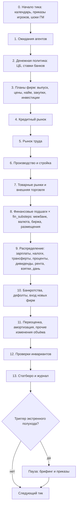

# 02. Время: тик, ход и порядок шагов

> Статус: согласован (v1.1) · Опирается на: [01. Бухгалтерия](01-accounting.md)

Модель живёт в двух масштабах времени. **Тик** — шаг расчёта, всегда один календарный месяц.
**Ход** — промежуток между решениями игроков: месяц, квартал или год, то есть 1, 3 или 12 тиков.
Режим хода меняет только число тиков, поэтому поведение экономики и её параметры не зависят от режима.

---

## 1. Тик

| Свойство | Значение |
| --- | --- |
| Длина | 1 календарный месяц (`tick_months = 1`, не настраивается) |
| Дата | у каждого тика год и месяц; тик 0 — стартовая дата партии из конструктора |
| Подшаги финансовых рынков | `fin_substeps` торговых дней внутри тика (по умолчанию 21): биржа, межбанк и валютный рынок торгуют подневно |
| Ставки и сроки | годовые величины переводятся в месячные (`(1 + r)^(1/12) − 1`), сроки кредитов и облигаций хранятся в тиках |

Финансовые рынки торгуют подневно, потому что паника, обвал курса и пузырь развиваются быстрее, чем производство.
Реальный сектор (найм, выпуск, стройка) принимает решения раз в тик.

### 1.1. Календарь

Многие события происходят не каждый тик. Их расписание хранится в данных эпохи и сценария.

| Событие | Расписание по умолчанию | Где настраивается |
| --- | --- | --- |
| Выплата зарплат | каждый тик | эпоха |
| Налоги | по видам: НДС и НДФЛ — каждый тик, налог на прибыль — авансом раз в квартал, итог по году — в марте | налоговый кодекс в данных |
| Купоны облигаций | по условиям выпуска (обычно раз в 6 тиков) | выпуск |
| Дивиденды | раз в год после годового собрания (апрель–июнь) | устав фирмы |
| Заседания ЦБ | 8 раз в год; если ЦБ управляет игрок — по его распоряжениям | ЦБ |
| Бюджетный год | январь–декабрь; принятие бюджета — ход до начала года | государство |
| Урожай | по культурам и регионам (зерновые — июль–сентябрь) | товар |
| Сезонный спрос | отопление, туризм, праздники | товар |
| Демография | рождения и смерти — каждый тик (в месячных долях), переход по возрастам — раз в год | эпоха |
| Учебный год | выпуск и приём в учебные заведения — июнь–сентябрь | эпоха |

## 2. Ход и его режимы

| Режим | Тиков за ход | Заседаний ЦБ за ход (при 8 в год) | Для чего |
| --- | --- | --- | --- |
| Месяц | 1 | 0–1 | острый кризис |
| Квартал | 3 | 2 | стандартная партия |
| Год | 12 | 8 | реформы и долгие процессы |

- Режим выбирается при настройке партии. **ГМ может переключить его между ходами** (например, перейти на месяцы на время кризиса).
  Переключение безопасно: тик не меняется, меняется только число тиков в следующем ходе.
- Ход начинается с брифинга по состоянию на конец предыдущего тика и заканчивается после расчёта последнего тика хода.

## 3. Приказы игроков

Игрок за ход отдаёт приказы трёх видов. Все они хранятся как данные и проверяются по правилам роли
(Минфин не может менять ставку ЦБ, если ЦБ независим).

| Вид | Когда исполняется | Пример |
| --- | --- | --- |
| **Разовый** | в начале первого тика хода | «снизить НДС до 18%», «выпустить облигации на 50 млрд» |
| **Отложенный** | в начале указанного тика хода | «со 2-го месяца хода повысить пенсии на 5%» |
| **Постоянное распоряжение** | проверяется каждый тик (или в тики заседаний ЦБ) до отмены или срока | «если инфляция за 12 месяцев выше 6%, повысить ставку на 0,5 п.п., не чаще раза в 2 месяца» |

Постоянное распоряжение записывается на языке формул из раздела 07:

```yaml
order: cb_inflation_rule
role: central_bank
when: "cb_meeting and cpi_yoy_official > 0.06"   # условие по официальным данным
do:
  - set: policy_rate
    value: "policy_rate + 0.005"
limits:
  min_ticks_between: 2
  max: 0.25                                        # потолок ставки
expires_tick: null
```

Правила исполнения:

1. Условия проверяются **по данным, которые видит игрок** (п. 6): официальной статистике, рыночным данным и данным его
   ведомства, а не по истинным счетам.
2. Если несколько распоряжений меняют один рычаг в одном тике, исполняется распоряжение с большим приоритетом; при равенстве — созданное раньше.
3. Каждое срабатывание пишется в журнал хода, и игрок видит его на брифинге.

## 4. Экстренный полуход

Если внутри длинного хода происходит острое событие, движок останавливается после текущего тика и даёт игрокам ответить,
не дожидаясь конца хода. Режим включает и выключает ГМ.

- **Триггеры** задаются в данных. По умолчанию: снятие более 5% депозитов банковской системы за тик; падение курса более чем на 15% за тик;
  рост спреда госдолга более чем на 3 п.п.; дефолт системного банка; ручной вызов ГМ.
- После остановки игроки получают брифинг и могут отдать приказы, которые вступают в силу со следующего тика.
  Оставшиеся тики хода затем досчитываются.
- Лимит — `max_emergency_per_turn` (по умолчанию 2), чтобы годовой ход не превратился в двенадцать месячных.

## 5. Порядок шагов внутри тика

Порядок фиксирован и хранится в данных сценария как список модулей, поэтому новый модуль добавляется вставкой в список, без правки ядра.



| Шаг | Что происходит | Модули (разделы) |
| --- | --- | --- |
| 0 | Применяются календарные события, приказы игроков на этот тик, срабатывают постоянные распоряжения, начинаются и заканчиваются шоки ГМ; демография за месяц | 07, 09 |
| 1 | Агенты обновляют ожидания инфляции, спроса, дохода и курса по доступной им информации (п. 6) | 03 |
| 2 | ЦБ меняет ставку и нормативы (в тик заседания или по распоряжению); банки пересчитывают ставки по кредитам и вкладам | 03, 05 |
| 3 | Фирмы планируют выпуск, цену, потребность в работниках, закупки и инвестиции, считают потребность в финансировании | 03, 04 |
| 4 | Заявки на кредиты, решения банков, выдача (здесь создаются деньги) | 05 |
| 5 | Вакансии и поиск работы, найм и увольнения, зарплаты | 05 |
| 6 | Закупка промежуточных товаров, выпуск в пределах мощности, труда, сырья и энергии; продвижение строек | 04, 05 |
| 7 | Покупки домохозяйств, государства, инвестиционные закупки, экспорт и импорт; дефицит, очереди, чёрные рынки | 05 |
| 8 | Подневная торговля: расчёты между банками и межбанк, валютные сделки по торговле и капиталу, биржа, аукционы облигаций | 05 |
| 9 | Все распределительные платежи тика | 01, 03 |
| 10 | Неплатёжеспособные агенты банкротятся по закону о банкротстве эпохи, долги списываются, появляются новые фирмы | 03 |
| 11 | Переоценка по рыночным ценам, износ капитала, порча запасов, разрушения и открытия | 01 |
| 12 | Все проверки из раздела 01, п. 10 | 01, 10 |
| 13 | Статбюро обновляет истинные счета и выпускает официальные оценки с задержкой; журнал сделок закрывается | 06 |

## 6. Кто что знает

Чтобы не было круговых зависимостей и «знания будущего», каждое решение принимается по информации, которая к этому моменту реально существует.

| Кто | Что видит при решении в тике t |
| --- | --- |
| Любой агент | свой баланс на начало тика, свои сделки прошлых тиков |
| Фирмы | цены и продажи своего рынка за тик t−1, цены конкурентов за t−1, официальную статистику с задержкой публикации |
| Банки | балансы и кредитную историю своих заёмщиков (чужих — только при `relationship_lending: off`, раздел 05, п. 10.1), ставку ЦБ тика t (после шага 2) |
| Домохозяйства | свой доход за t−1, цены, которые видели при покупках, официальную инфляцию с задержкой |
| Участники финансовых рынков | цены предыдущего торгового дня |
| Игроки | официальную статистику, рыночные данные, данные своего ведомства (раздел 06, п. 7), свой журнал приказов и то, что ГМ решил открыть |
| ГМ | всё, включая истинные счета |

Внутри шага агенты действуют в случайном порядке, который перемешивается каждый тик. Это убирает преимущество агента,
который всегда ходит первым.

## 7. Детерминизм

Одинаковый мир, одинаковые приказы и одинаковое зерно дают одинаковый результат до последней копейки.

- **Отдельный поток случайных чисел на каждый модуль**, выводится из зерна партии и имени модуля. Добавление нового модуля не меняет случайность в остальных.
- Порядок обхода агентов задаётся только этими потоками, никогда порядком в памяти.
- Параллельные вычисления разрешены внутри шага, если результат собирается в фиксированном порядке.
- Числа с плавающей точкой в поведенческих расчётах считаются одинаково на всех машинах (без «быстрой» математики компилятора).

## 8. Снимки и откат

- Снимок мира сохраняется в начале каждого хода и после каждого тика (частота тиковых снимков — настройка).
- ГМ может откатить партию к любому снимку и, если хочет, пересчитать с другими приказами — так создаётся ветка мира.
- Игроки могут прогонять «что если» на копии мира, если ГМ разрешил: копия не влияет на партию, а её результат показывается
  только по официальной статистике и с пометкой «прогноз».

## 9. Предварительные цели по скорости

| Конфигурация | Цель на тик | Год (12 тиков) |
| --- | --- | --- |
| 1 страна, ~50 тыс. агентов и когорт | ≤ 1 с | ≤ 15 с |
| 5 стран игроков + 5 ИИ-стран | ≤ 5 с | ≤ 1 мин |

Цели уточнятся после прототипа.

## 10. Принятые решения

Решения согласованы с Романом в ревью PR #2 (25 октября 2026).

| Вопрос | Решение |
| --- | --- |
| Длина тика | месяц для всех эпох |
| Срабатывание чужих постоянных распоряжений (например, решение ЦБ соседней страны) | игроки видят его как публичную новость |
| Триггеры экстренного полухода | значения по умолчанию из п. 4, ГМ меняет их в партии |
| Прогоны «что если» | по умолчанию выключены, включает ГМ |
