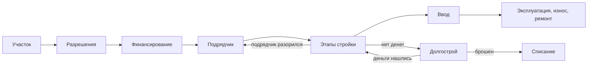

# 04. Производство: товары, рецепты, капитал, технологии, запасы, стройка

> Статус: v0.2 · решения по ревью — в п. 16 · Опирается на: [01. Бухгалтерия](01-accounting.md), [02. Время](02-time.md), [03. Агенты](03-agents.md)
> Основа: таблицы «затраты–выпуск» (как в Poledna et al. 2023), Johansen 1959 (putty-clay), Nelson–Phelps 1966 (догоняющее развитие),
> Flyvbjerg et al. 2002 (перерасход смет), Bom–Ligthart 2014 (производительность инфраструктуры),
> Pichler et al. 2022 (критические входы), Basker 2005 (торговые сети)

Раздел описывает, **как из труда, капитала, сырья и энергии получается выпуск**: какие бывают товары и отрасли, как устроен рецепт
производства, как стареет капитал и приходят новые технологии, как работают запасы и цепочки поставок, как идут стройка
и инфраструктура. Решения фирм о том, сколько производить и инвестировать, описаны в разделе 03, торговля между агентами — в разделе 05.

Здесь же закрыты три пункта из [проверки модели на кризисы](https://claude.ai/artifact/SDZaDY5eXienaBTp2a1MQ4):
энергию и сырьё в коротком периоде почти нечем заменить (п. 3), поставки идут со сроком и могут сорваться (п. 6),
месторождения истощаются (п. 9).

Как и в разделе 03, каждое правило — формула по умолчанию из данных, параметры собраны в п. 14, приоритет отмечен как
**ядро**, **v1** или **v2**.

---

## 1. Товары (ядро)

Товар — запись в каталоге данных. Каталог задаёт пакет эпохи, сценарий может добавлять и убирать товары.

| Поле | Содержание |
| --- | --- |
| `id`, `name`, `unit` | идентификатор, название, натуральная единица (тонна, кВт·ч, м², штука, человеко-час услуги) |
| `kind` | `food`, `energy`, `raw`, `intermediate`, `consumer`, `durable`, `capital`, `construction`, `service`, `military`, `illegal` |
| `industry` | отрасль, которая его выпускает (п. 2) |
| `storable`, `spoil_rate` | можно ли хранить; доля запаса, которая портится за тик |
| `store_cost` | стоимость хранения, доля стоимости запаса за тик (в формуле придержания товара в разделе 03, п. 4.2 — `c_store`) |
| `tradability` | `world` (торгуется между странами), `national` (между регионами страны), `local` (только в регионе: услуги, электричество вне сети, жильё) |
| `transport_cost` | стоимость перевозки на единицу расстояния, доля цены |
| `durability` | срок службы для товаров длительного пользования и капитала, тики |
| `season` | помесячный профиль выпуска или спроса (урожай, отопление) |
| `available` | годы, когда товар существует (автомобиль, телевизор, компьютер, смартфон появляются по эпохам) |
| `essential` | входит ли в прожиточный минимум (`γ` в п. 3.4 раздела 03) |
| `elasticity`, `armington_sigma` | эластичность спроса и замещения импортом (раздел 03) |
| `quality_range` | разброс качества между производителями (v1) |

Услуги не хранятся: их выпуск равен потреблению в том же тике, а неудовлетворённый спрос теряется или ждёт в очереди
(очереди к врачу).

## 2. Отрасли (ядро)

Отрасли повторяют структуру таблицы «затраты–выпуск» статистики. Базовый пакет — около 35 отраслей и 80 товаров;
для аналитиков есть полная таблица из 64 отраслей (как в национальных счетах ЕС). Детализация — настройка данных:
отрасль или товар можно разбить или слить без правки кода, а генератор (раздел 08) собирает 35 отраслей из таблицы на 64.
Почему такого числа хватает, разобрано в [документе по детализации](https://claude.ai/artifact/4ZfNWijqh7kV3EBDkThhmd).

| Группа | Отрасли базового пакета |
| --- | --- |
| Первичный сектор | растениеводство, животноводство, лес и рыба; добыча нефти, газа, угля, руд, прочая добыча |
| Энергетика | генерация электроэнергии, сети, тепло, нефтепереработка |
| Обработка | пищевая, лёгкая, деревообработка и бумага, химия, металлургия, машиностроение, автомобили и транспорт, электроника, оборонная, стройматериалы |
| Стройка | жилищное, промышленное, инфраструктурное строительство |
| Услуги рынка | торговля, транспорт и склады, связь, финансы (выручка банков и посредников), недвижимость, гостиницы и туризм, бизнес-услуги, бытовые услуги |
| Нерыночные услуги | государственное управление, оборона, образование, здравоохранение, социальные услуги |

Для каждой отрасли данные задают доступные рецепты (п. 3), виды капитала, состав работников по квалификациям, эффект масштаба,
барьеры входа, признак естественной монополии и правила регулирования.

Игрок может приказом (раздел 02, п. 3) создать госкомпанию в любой отрасли, в том числе своего подрядчика для стройки.
Капитал вносит бюджет, работников компания нанимает на рынке труда, дальше она действует по правилам госкомпании
(раздел 03, п. 4.11) и по приказам игрока.

### 2.1. Когда товар выделяется отдельно

Два товара сливаются в один, только если совпадают по всем признакам ниже. Различие хотя бы в одном — повод держать их
отдельно, иначе модель теряет связанный с ним кризис.

| Признак | Пример | Что теряется при слиянии |
| --- | --- | --- |
| не хранится | электроэнергия, услуги | веерные отключения |
| критический вход, который нечем заменить в коротком периоде (п. 3) | нефть, газ, микросхемы | нефтяной шок, остановка заводов |
| входит в прожиточный минимум | хлеб, отопление | голод, бунты из-за цен |
| цену регулирует государство | тарифы, топливо, хлеб | дефицит и чёрный рынок |
| разная торгуемость | зерно и стрижка | импортная инфляция при падении курса |
| мало производителей в мире | микросхемы, редкие металлы | санкции и блокада |
| покупку можно отложить | автомобили, техника | глубокий спад спроса в рецессию |
| игрок управляет им отдельно | акциз на алкоголь, квота на зерно, госрезерв | рычагу игрока не к чему приложиться |

### 2.2. Узкие места в базовом пакете

Базовый пакет обязательно содержит товары, срыв поставки которых останавливает целые отрасли. Часть из них уже есть
среди обычных товаров отраслей, новых — около 20.

| Группа | Товары |
| --- | --- |
| Топливо | сырая нефть, бензин, дизель, мазут, природный газ, уголь, ядерное топливо |
| Удобрения | азотные (делаются из газа), калийные и фосфорные |
| Металлы | сталь, алюминий, медь, редкие металлы, литий (с 2000-х) |
| Комплектующие | микросхемы (со второй половины XX века), станки, детали двигателей |
| Медицина | лекарства, фармсубстанции, вакцины |
| Еда | зерно, корма, мясо, молоко, сахар, растительное масло |
| Оборона | боеприпасы, военная техника |

Потребительская корзина — около 25 групп: отдельно идут еда, жильё и коммунальные услуги, бензин, алкоголь и табак,
товары длительного пользования, медицина, образование, связь, транспорт и отдых. Тогда закон Энгеля и разная инфляция
для бедных и богатых децилей получаются сами.

## 3. Рецепт производства (ядро)

Рецепт — способ выпускать товар. У отрасли может быть несколько рецептов (электричество из угля, газа, воды, атома; перевозки
лошадьми или грузовиками), и эпоха определяет, какие из них доступны.

```yaml
recipe: power_gas_ccgt
output: { electricity: 1.0 }            # кВт·ч; возможны совместные продукты (нефтепереработка)
inputs:                                 # a — расход на единицу выпуска; critical — без этого входа выпуска нет
  natural_gas:          { a: 0.18,  critical: true }
  services_maintenance: { a: 0.004, critical: false }
labor:  { high: 0.00002, medium: 0.00004 }   # человеко-часов на единицу при технологическом уровне 1
capital: { kind: plant_power, per_capacity: 0.9 }  # капитал (в ценах базового года) на 1 кВт·ч месячной мощности
land:    { kind: industrial, per_capacity: 0.0 }
min_scale: 200_000_000                  # кВт·ч в месяц (около 300 МВт): меньше — дороже из-за эффекта масштаба
available: { from: 1990 }
```

Выпуск фирмы за тик ограничен самым узким местом (функция Леонтьева):

```
A = A_tech(поколение) · A_firm · A_infra(регион) · A_shock
Y ≤ мощность = Σ_поколения K_v / k_r · u_max
Y ≤ L_s · A / l_{r,s}             для каждой квалификации s
Y ≤ M_i / a_{r,i}                 для каждого критического входа i, включая энергию
Y ≤ LAND · урожайность            для сельского хозяйства (п. 8)
Y ≤ добычная мощность             для добычи (п. 9)
```

- `A_tech` — технологический уровень поколения капитала (п. 5), `A_firm` — собственная эффективность фирмы (разброс между фирмами
  даёт лидеров и аутсайдеров), `A_infra` — вклад инфраструктуры и госуслуг региона (п. 11), `A_shock` — шок ГМ (пандемия, война,
  забастовка).
- **В коротком периоде критические входы нельзя заменить.** Если подорожала нефть, завод не может сразу тратить её меньше:
  он платит дороже или сокращает выпуск. Поэтому нефтяной шок бьёт по всей экономике сразу (стагфляция).
- **Критические и некритические входы** (как у Pichler et al. 2022). Каждый вход рецепта помечен в данных. Без критического
  входа (газ для электростанции, сталь для автозавода, микросхемы для электроники) выпуска нет. Нехватка некритического
  (реклама, консалтинг, часть ремонта) выпуск не ограничивает. Если она длится дольше `noncrit_grace` тиков, эффективность
  фирмы снижается: `A_firm × (1 − noncrit_penalty · доля недополученных некритических входов)`, пока закупки не возобновятся.
  - При нехватке денег фирма сначала режет некритические закупки, поэтому в рецессию первыми падают реклама и бизнес-услуги.
  - По умолчанию критические — энергия, сырьё, материалы и комплектующие, которые физически входят в продукт или процесс;
    остальные входы некритические. Пакет эпохи может переопределить пометку.
  - Без этого деления шоки выходят слишком тяжёлыми. В проверке Pichler et al. на данных Великобритании 2020 года жёсткость
    всех входов при сильном шоке обваливала выпуск на 50%, а версия с критическими входами дала прогноз ВВП с ошибкой 0,6%.
- **Замещение — через новые инвестиции** (putty-clay по Johansen 1959). Новое поколение капитала фирма ставит под рецепт,
  который даёт наименьшую себестоимость по ожидаемым ценам:

  ```
  P(рецепт r) ∝ exp(−recipe_logit · (UC_r + годовая стоимость капитала_r) / средняя по рецептам)
  ```

  Поэтому при долгом росте цены нефти новые электростанции строятся на газе или угле, а долгосрочная эластичность получается
  намного выше краткосрочной, как в жизни.
- Данные могут задать **группу замещения** — входы, которые заменяют друг друга уже на старом капитале (котёл на угле и мазуте)
  с эластичностью `sr_sigma`. По умолчанию групп нет.

## 4. Капитал и его поколения (ядро)

Капитал хранится поколениями: каждое поколение — это сумма вложений одного тика под один рецепт с технологическим уровнем того времени.

| Вид капитала | Износ за тик | Срок поставки | Пример |
| --- | --- | --- | --- |
| `equipment` | 0,010 (около 11% в год) | 3 тика | станки, оборудование |
| `transport` | 0,012 (около 13% в год) | 3 тика | грузовики, суда |
| `structures` | 0,003 (около 3,5% в год) | стройка (п. 10) | цеха, склады |
| `plant_*` | по виду | стройка (п. 10) | электростанции, шахты, НПЗ |
| `herd` | падёж и забой (v2) | — | скот |

- **Физический износ** списывает долю поколения на шаге 11 (раздел 02). Ремонт, оплаченный фирмой, снижает износ.
- **Моральный износ.** Если переменная себестоимость выпуска на поколении (сырьё, энергия, труд; вложения в капитал уже потрачены)
  `scrap_ticks` тиков подряд выше цены, фирма выводит его из работы.
  Так при новой технологии или дорогом сырье старые заводы закрываются, а регионы со старой промышленностью теряют работу.
- **Перепродажа.** Установленный капитал продаётся другой фирме со скидкой `resale_discount`: завод трудно продать по цене постройки.
- **Срок поставки.** Заказанное оборудование приходит через `lead_time` тиков, импортное — дольше (п. 6). Здания и крупные
  объекты строятся проектами (п. 10).

## 5. Технологии (ядро, исследования и патенты — v1)

- **Мировой фронтир.** Пакет эпохи задаёт для каждой отрасли рецепты с годами появления и рост производительности на фронтире
  `g_frontier` (доля в год).
- **Положение страны.** У страны в каждой отрасли есть уровень `T ∈ (0, 1]` относительно фронтира. Новое поколение капитала
  получает производительность `фронтир · T`. Отставание сокращается по Nelson–Phelps:

  ```
  ΔT_год = kappa_catch · (1 − T) · absorb
  absorb = f(квалификация работников, импорт оборудования, иностранные фирмы в отрасли, лицензии)
  ```

  Чем больше отставание и чем лучше страна умеет перенимать, тем быстрее она догоняет. Без доступа к импортному оборудованию
  (санкции, автаркия) догонять труднее.
- **Правки ГМ.** ГМ может на любом этапе партии менять фронтир, его рост `g_frontier`, уровень страны `T` и годы появления
  рецептов и товаров (раздел 09).
- **Исследования (v1).** Расходы фирм и государства на R&D повышают `T` выше догоняющего уровня и могут дать собственный новый рецепт
  или товар. Патент на `patent_ticks` тиков закрывает рецепт для других фирм, поэтому наценку владельца ограничивает
  только эластичность спроса (раздел 03, п. 4.3).
- **Новые товары (v1).** Когда товар появляется по эпохе, его доля в расходах домохозяйств (`β` в разделе 03) растёт по кривой
  распространения и быстрее растёт при падении цены.

## 6. Запасы и цепочки поставок (ядро)

- **Запасы сырья.** Фирма держит запас каждого входа на `input_buffer_months` месяцев расхода. Эпоха и отрасль задают
  стиль: «точно в срок» (малый запас, дёшево в спокойное время) или «на всякий случай».
- **Поставщики.** У фирмы по каждому входу до `n_suppliers` постоянных поставщиков. Заказ приходит через срок поставки:

  ```
  lead_time = lead_base(товар) + расстояние / пропускная способность маршрута + таможня (для импорта)
  ```

- **Срыв поставки.** Если поставщик не может отгрузить (дефицит, банкротство, санкции, блокада, закрытие границ), фирма
  1. тратит запас;
  2. ищет нового поставщика `search_ticks` тиков и платит дороже;
  3. сокращает выпуск по узкому месту из п. 3.

  Сокращение выпуска у одной фирмы — срыв поставки у её покупателей. Так шок распространяется по сети поставок, как при пандемии
  или санкциях, и сильнее там, где запасы малы.
- **Склад готовой продукции** и придерживание товара при ожидаемом росте цен описаны в разделе 03, п. 4.2.
- Порча запасов списывается на шаге 11 по `spoil_rate`, хранение оплачивается по `store_cost`.

## 7. Энергия (ядро — ограничение, v1 — энергосистема)

- **Электроэнергия** не хранится и передаётся только по сетям. Её предложение в регионе — мощность электростанций плюс переток
  по сетям из соседних регионов минус потери `grid_loss`.
- **Дефицит.** Если спрос больше предложения:
  - при свободной цене она растёт до баланса;
  - при регулируемом тарифе начинаются веерные отключения: потребители отключаются по списку приоритетов из данных
    (больницы, затем домохозяйства, затем промышленность), а выпуск фирм падает по п. 3.
- Тариф ниже издержек ведёт к недоинвестициям в генерацию (раздел 03, п. 4.3), и через несколько лет дефицит становится хроническим.
- **Топливный баланс (v1).** Электростанции, транспорт и котельные покупают топливо как обычные входы рецептов, поэтому нефтяной
  и газовый шок проходит через электричество и перевозки во все цены.

## 8. Сельское хозяйство (ядро — сезонность, v1 — урожайность)

- Урожай приходит в месяцы уборки по календарю культуры и региона (раздел 02, п. 1.1). Затраты — семена, удобрения, топливо,
  труд, техника — идут весь сезон, поэтому фирма кредитуется до урожая.
- Урожайность:

  ```
  yield = base · качество земли · интенсивность затрат · T · exp(weather)
  weather ~ N(0, weather_sd), коррелирует между соседними регионами (weather_corr); засуху задаёт ГМ
  ```

- Зерно хранится до следующего урожая с порчей. Неурожай при малых запасах и потолке цен ведёт к дефициту и голоду (раздел 03, п. 3.3).
- Устройство земли (колхоз, частная собственность, запрет продажи) задаёт эпоха через правила рынка земли (раздел 05).

## 9. Добыча и природные ресурсы (ядро, разведка — v1)

- Месторождение (`NATRES`) — запас в натуральных единицах в регионе, с качеством и владельцем лицензии.
- Себестоимость растёт по мере истощения:

  ```
  UC_добычи = UC_0 · (R_0 / R)^eta_depl
  ```

  Поэтому богатая ресурсами страна со временем добывает всё дороже, а при падении мировой цены первыми закрываются старые месторождения.
- Добычная мощность — капитал по рецепту (скважины, шахты). Лицензия и рента — у государства (раздел 03, п. 8.2), цена — на мировом
  рынке (раздел 05).
- **Разведка (v1).** Вложения в разведку с вероятностью дают новое месторождение случайного размера. Крупное открытие запускает
  сырьевой бум со всеми последствиями «голландской болезни».

## 10. Стройка (ядро)

Стройка — это проект со сроком, сметой и рисками, а не мгновенная покупка здания. Проекты конкурируют за одни и те же
строительные фирмы, цемент, сталь и рабочих, поэтому бум стройки сам разгоняет её цены. Деньги на стройку уходят задолго
до того, как объект начнёт приносить доход; по Kydland–Prescott (1982) эта задержка сама по себе усиливает колебания экономики.
Рынок участков и готового жилья описан в разделе 05.

### 10.1. Проект

| Поле | Содержание |
| --- | --- |
| `type` | жильё, коммерческое или промышленное здание, объект инфраструктуры (дорога, ж/д, мост или тоннель, порт, электростанция, сеть) |
| `owner`, `plot` | заказчик и участок земли (раздел 05) с подходящим зонированием |
| `estimate` | смета и срок, объявленные при старте |
| `stages` | этапы с долями затрат: материалы, техника, труд строителей по квалификациям |
| `contractor` | строительная фирма (или несколько) |
| `financing` | свои деньги, кредит, проектное финансирование, бюджет, ГЧП, концессия, инфраструктурные облигации |

### 10.2. Жизненный цикл



1. **Участок.** Покупка, аренда или изъятие (раздел 05); если зонирование не подходит, нужна смена зонирования.
2. **Разрешения** занимают `permit_ticks · bureaucracy` тиков. Взятка ускоряет их (раздел 03, п. 3.12).
3. **Финансирование** собирается до старта; банк проверяет проект как обычного заёмщика.
4. **Подрядчик.** У него должна быть свободная мощность.
   - Для госзаказа подрядчика выбирает игрок: тендером (дольше на `tender_ticks`, цена ниже) или напрямую (сразу, но
     вероятность отката умножается на `direct_award_risk`). Подрядчиком может быть и госкомпания, созданная игроком (п. 2).
   - Фирмы, домохозяйства и банки для своих проектов выбирают подрядчика сами по логит-правилу от цены, свободной мощности
     и репутации (доли сорванных сроков в прошлых проектах).
5. **Этапы.** Каждый тик подрядчик продвигает проект:

   ```
   прогресс = min(план, материалы / нужно, рабочие / нужно) · сезон(климат, месяц) · производительность подрядчика
   ```

   Зимой в холодном климате стройка замедляется (`winter_factor`). Заказчик платит по этапам.
6. **Ввод.** Объект становится рабочим активом: мощностью завода, квартирами на рынке, пропускной способностью дороги.
7. **Эксплуатация.** Износ и ремонт по п. 4 и п. 11.

### 10.3. Риски

- **Перерасход сметы.** При старте проект тайно получает множитель перерасхода из распределения по типу объекта и раскрывает его
  постепенно по этапам. Заказчик узнаёт настоящую цену по ходу дела, как в жизни. По умолчанию для транспорта — данные
  Flyvbjerg et al. (2002) по 258 проектам; для зданий — предварительные значения (п. 14.5).
- **Удорожание из-за рынка.** Сверх этого смета растёт, если в стройбум дорожают материалы и труд.
- **Откаты.** При коррупции часть платежей уходит чиновникам и подрядчику, объект выходит дороже и хуже: у инфраструктуры ниже
  пропускная способность и быстрее износ.
- **Долгострой.** Если заказчику нечем платить, проект замораживается и ветшает (`frozen_decay`). Его можно достроить, продать
  или списать.
- **Банкротство подрядчика.** Проект стоит, пока не найден новый подрядчик; перезапуск стоит `remobilization_cost` от остатка сметы.

### 10.4. Учёт

По правилам СНС: если объект строится по договору с заказчиком, незавершённая стройка — актив заказчика (`K`, `HOUSE` или `INFRA`
с признаком `under_construction`, без мощности). Если застройщик строит на продажу, это его запасы (`INV`, незавершённое производство)
до продажи. Новые инструменты в раздел 01 не добавляются.

## 11. Инфраструктура (ядро)

| Вид | Что даёт |
| --- | --- |
| Дороги, ж/д, порты | стоимость и срок перевозки между регионами и за рубеж |
| Энергосети, трубопроводы | переток электроэнергии и топлива (п. 7) |
| Вода, связь | ограничение для жилья и фирм в регионе, производительность |

- **Производительность.** Инфраструктура региона повышает производительность всех фирм в нём:

  ```
  A_infra = (INFRA_основная на человека / норма эпохи)^phi_infra
  ```

  По метаанализу Bom–Ligthart (2014) краткосрочная эластичность выпуска по госкапиталу — около 0,08, долгосрочная — около 0,12.
  В v1 сюда добавляется множитель качества госуслуг `(качество / норма эпохи)^phi_gov` (раздел 03, п. 8.7).
- **Заторы.** Когда загрузка маршрута приближается к пропускной способности, время и стоимость перевозки растут резко,
  по функции Бюро дорог США (BPR):

  ```
  время = время_0 · (1 + bpr_alpha · (загрузка / пропускная способность)^bpr_beta)
  ```

- **Цена земли** рядом с новой дорогой или станцией метро растёт (раздел 05).
- **Износ и содержание.** Инфраструктура изнашивается на `delta_infra` за тик. Если на содержание тратят меньше нормы, состояние
  объекта падает, вместе с ним падает пропускная способность и растёт риск аварий (событие для ГМ).
- **Операторы** — государство, госкомпании и концессионеры. Тарифы естественных монополий регулируются (раздел 03, п. 4.3).

## 12. Торговля, услуги и перевозки (ядро)

### 12.1. Цена покупателя

- Услуги производятся и потребляются в одном тике (п. 1). Мощность услуг — в основном работники и помещения.
- **Цена покупателя** складывается как в таблицах «затраты–выпуск»: цена производителя + оптовая и розничная наценка +
  транспортная наценка + налоги. По СНС выпуск торговли — это наценка, а не оборот. Наценки — выпуск отраслей торговли
  и транспорта, поэтому торговые и транспортные фирмы получают выручку и нанимают людей.

### 12.2. Кто торгует

| Вид | Что делает | Эпоха |
| --- | --- | --- |
| Оптовик и импортёр | покупает у производителей и за рубежом, продаёт рознице и фирмам | все |
| Независимая розница | магазины, рынки, киоски: мало капитала, высокие расходы на единицу, больше наличных и тени | все |
| Торговая сеть | много магазинов в нескольких регионах, свои склады, закупки напрямую у производителей (п. 12.3) | все, массово со второй половины XX века |
| Госторговля | магазины государства с фиксированными ценами, очередями и торговлей «из-под прилавка» (раздел 03, п. 3.5 и 4.8) | плановая экономика |
| Маркетплейс (v1) | продаёт по всей стране с доставкой, без своих магазинов | с 2000-х |

Покупатель выбирает продавца по правилу раздела 03, п. 3.4. Продавцы, которых видит когорта, выбираются случайно
с вероятностью по торговой площади, поэтому большой магазин сети попадает в выбор чаще маленькой лавки.

### 12.3. Торговая сеть

**Состояние:** магазины по регионам с торговой площадью, склады (`INV`), ассортимент, цены по регионам, договоры
с поставщиками, долг поставщикам (`TC`).

**Закупка.** Сеть покупает у производителя или оптовика. Чем большую долю продаж поставщика она забирает, тем большую
скидку получает:

```
скидка = min(max_discount, bp_max · (доля сети в продажах поставщика)^bp_eta)
```

Сеть платит поставщику через `pay_delay` тиков. До оплаты долг висит как торговый кредит (`TC`, раздел 01), то есть
поставщики кредитуют сеть. Потолок скидки `max_discount` и предельный срок оплаты задаёт закон о торговле (рычаг игрока).

**Цена.** Себестоимость единицы — закупочная цена плюс расходы магазина на единицу (труд, аренда, логистика). Цену сеть
ставит по правилу раздела 03, п. 4.3 с рыночной властью на местном рынке; единую по стране или по регионам (данные).
Расходы на единицу падают с размером сети:

```
расходы на единицу = opex_0 · (продажи сети / opex_ref)^(−chain_scale)
```

Поэтому сеть дешевле лавки. По Basker (2005), приход Walmart снижал цены на часть товаров на 1,5–3% сразу и примерно
вчетверо сильнее через несколько лет.

**Запасы и дефицит.** Склады сети живут по правилам запасов раздела 03, п. 4.2 и цепочек поставок п. 6. При потолке цен
или панике покупателей сеть вводит лимит в одни руки `ration_per_buyer`; часть товара уходит на чёрный рынок через
работников (раздел 03, п. 4.8).

**Рост.** Новый магазин — инвестиция: аренда или покупка площади (раздел 05) либо стройка (п. 10). Сеть открывает
магазин там, где ожидаемая выручка с метра выше нормы, и закрывает убыточный после `scrap_ticks` тиков убытка.

**Тень.** Сеть принимает карты, и проверяют её чаще: вероятность проверки растёт с размером фирмы (раздел 03, п. 4.7).
Поэтому переход покупателей с рынков в сети сам повышает собираемость налогов.

**Рычаги игрока:** потолок скидки и срок оплаты поставщикам, потолок наценки на социальные товары, запрет крупных
магазинов в зоне (раздел 05), предельная доля сети на рынке региона (антимонопольный орган, раздел 03, п. 4.13).

### 12.4. Что из этого следует

- Банкротство крупной сети замораживает её долг поставщикам (`TC`), и следом разоряются мелкие производители.
- Сильная сеть давит закупочные цены: доходы фермеров падают, даже когда розничные цены растут.
- Рост сетей вытесняет лавки и рынки: цены и тень снижаются, работников в торговле становится меньше.
- При потолке цен первыми пустеют полки сетей, а товар уходит на рынки и в чёрный сектор.

## 13. Военное производство (v1)

Оборонные товары выпускаются по своим рецептам, покупает их только государство. Гражданский завод можно перевести на военный рецепт:
это переналадка капитала со сроком и стоимостью из данных. Мобилизацию (уход работников в армию) задаёт ГМ шоком на предложение труда.

## 14. Параметры по умолчанию

Значения предварительные и уточняются калибровкой (разделы 08 и 10), кроме отмеченных источником.

### 14.1. Товары и запасы

| id | Смысл | Единица | Диапазон | По умолчанию |
| --- | --- | --- | --- | --- |
| `spoil_rate` | порча запаса | доля за тик | 0–1 | по товару (зерно 0,005, свежие продукты 0,3) |
| `store_cost` | стоимость хранения | доля стоимости за тик | 0–0,05 | 0,005 |
| `input_buffer_months` | запас сырья и комплектующих | месяцы расхода | 0–6 | 1 (эпоха и отрасль) |
| `n_suppliers` | постоянных поставщиков на вход | шт. | 1–10 | 3 |
| `search_ticks` | поиск нового поставщика | тики | 0–12 | 2 |
| `lead_base` | базовый срок поставки внутри страны | тики | 0–6 | 1 |
| `lead_import` | добавка к сроку для импорта | тики | 0–12 | 2 |

### 14.2. Рецепты и капитал

| id | Смысл | Единица | Диапазон | По умолчанию |
| --- | --- | --- | --- | --- |
| `u_max` | максимальная загрузка мощности | доля | 0,8–1,2 | 1,0 |
| `recipe_logit` | чувствительность выбора рецепта к себестоимости | — | 0–50 | 10 |
| `sr_sigma` | эластичность замещения внутри группы на старом капитале | — | 0–1 | 0 |
| `delta_equipment` / `delta_transport` / `delta_structures` | износ капитала | доля за тик | 0–0,05 | 0,010 / 0,012 / 0,003 |
| `capital_lead_time` | срок поставки оборудования | тики | 0–24 | 3 |
| `scrap_ticks` | тиков убыточности до вывода поколения | тики | 1–36 | 6 |
| `resale_discount` | скидка при продаже установленного капитала | доля | 0–0,9 | 0,5 |
| `firm_eff_sd` | разброс эффективности фирм (логнормальный) | σ логарифма | 0–1 | 0,3 |
| `noncrit_grace` | сколько тиков фирма обходится без некритического входа без потерь | тики | 0–24 | 3 |
| `noncrit_penalty` | падение эффективности при долгой нехватке некритических входов | доля на единицу нехватки | 0–1 | 0,1 |

### 14.3. Технологии

| id | Смысл | Единица | Диапазон | По умолчанию |
| --- | --- | --- | --- | --- |
| `g_frontier` | рост производительности на мировом фронтире | доля в год | 0–0,05 | 0,015 (эпоха и отрасль) |
| `kappa_catch` | скорость догоняющего развития | доля разрыва в год | 0–0,2 | 0,03 |
| `patent_ticks` | срок действия патента (v1) | тики | 0–360 | 240 (20 лет) |

### 14.4. Энергия, сельское хозяйство, добыча

| id | Смысл | Единица | Диапазон | По умолчанию |
| --- | --- | --- | --- | --- |
| `grid_loss` | потери в сетях | доля | 0–0,3 | 0,06 |
| `blackout_priority` | порядок отключений | список | — | больницы → домохозяйства → промышленность |
| `weather_sd` | разброс урожайности от погоды | σ логарифма | 0–0,5 | 0,1 |
| `weather_corr` | корреляция погоды соседних регионов | — | 0–1 | 0,6 |
| `eta_depl` | рост себестоимости добычи с истощением | — | 0–2 | 0,5 |

### 14.5. Стройка и инфраструктура

| id | Смысл | Единица | Диапазон | По умолчанию |
| --- | --- | --- | --- | --- |
| `overrun_rail` | перерасход сметы ж/д: среднее / разброс | доля | — | 0,447 / 0,384 (Flyvbjerg et al. 2002) |
| `overrun_fixed_link` | мосты и тоннели | доля | — | 0,338 / 0,624 (Flyvbjerg et al. 2002) |
| `overrun_road` | дороги | доля | — | 0,204 / 0,299 (Flyvbjerg et al. 2002) |
| `overrun_building` | здания и заводы | доля | — | 0,2 / 0,3 (предварительно) |
| `permit_ticks` | базовый срок разрешений | тики | 0–24 | 3 |
| `tender_ticks` | срок тендера по госзаказу | тики | 0–6 | 2 |
| `direct_award_risk` | рост вероятности отката при выборе подрядчика без тендера | множитель | 1–5 | 2 |
| `bureaucracy` | множитель срока разрешений | — | 0,5–5 | 1 (сценарий) |
| `winter_factor` | скорость стройки зимой в холодном климате | доля | 0–1 | 0,5 |
| `frozen_decay` | ветшание долгостроя | доля за тик | 0–0,05 | 0,005 |
| `remobilization_cost` | перезапуск после смены подрядчика | доля остатка сметы | 0–0,3 | 0,05 |
| `phi_infra` | эластичность производительности по инфраструктуре | — | 0–0,3 | 0,08 (Bom–Ligthart 2014) |
| `phi_gov` | эластичность производительности по качеству госуслуг (v1) | — | 0–0,3 | 0,05 (предварительно) |
| `bpr_alpha` / `bpr_beta` | функция заторов | — | — | 0,15 / 4 (BPR) |
| `delta_infra` | износ инфраструктуры | доля за тик | 0–0,01 | 0,002 |

### 14.6. Торговля

| id | Смысл | Единица | Диапазон | По умолчанию |
| --- | --- | --- | --- | --- |
| `bp_max` | наибольшая скидка, которую сеть получает у поставщика | доля цены | 0–0,5 | 0,15 |
| `bp_eta` | как быстро скидка растёт с долей сети в продажах поставщика | — | 0,5–2 | 1 |
| `max_discount` | законный потолок скидки | доля цены | 0–0,5 | нет (сценарий) |
| `pay_delay` | срок оплаты поставщику | тики | 0–6 | 1 |
| `chain_scale` | экономия на масштабе сети | — | 0–0,3 | 0,1 |
| `opex_0` | расходы магазина на единицу товара у эталонной сети | доля цены | 0–0,5 | калибровка по наценке торговли |
| `opex_ref` | размер сети, при котором расходы на единицу равны `opex_0` | продажи за тик | — | калибровка |
| `ration_per_buyer` | лимит в одни руки при дефиците | кратность обычной покупки | 1–5 | 2 |

## 15. Какие кризисы порождает этот раздел

| Кризис | Механизм |
| --- | --- |
| Нефтяной шок и стагфляция | энергия — критический вход почти всех рецептов (п. 3), замещение только через новые инвестиции |
| Срыв цепочек поставок (пандемия, санкции, блокада) | сроки поставки, малые запасы, распространение по сети поставщиков (п. 6) |
| Энергодефицит и веерные отключения | электричество не хранится, тариф ниже издержек тормозит стройку электростанций (п. 7) |
| Неурожай и голод | погода, малые запасы зерна, потолок цен (п. 8) |
| Сырьевой цикл и «голландская болезнь» | истощение, мировая цена, открытия месторождений (п. 9) |
| Стройбум, перерасход и долгострой | общая мощность стройки, раскрытие перерасхода, заморозка при сжатии кредита (п. 10) |
| Износ инфраструктуры | недофинансирование содержания снижает пропускную способность и производительность (п. 11) |
| Упадок промышленных регионов | моральный износ старых поколений капитала при новой технологии или дорогом сырье (п. 4) |
| Цепочка неплатежей после банкротства сети | долг сети поставщикам замораживается (п. 12.3) |
| Пустые полки | потолок цен, паника покупателей, малые запасы сетей (п. 12.3) |

## 16. Принятые решения

Ответы на ревью PR #5 (25 октября 2026).

| № | Вопрос | Решение |
| --- | --- | --- |
| 1 | Детализация базового пакета | Около 35 отраслей и 80 товаров вместо 60: добавлены узкие места по правилу п. 2.1. Пакет из 64 отраслей — для аналитиков. Предложено в [документе по детализации](https://claude.ai/artifact/4ZfNWijqh7kV3EBDkThhmd), ждёт подтверждения |
| 2 | Замещение ресурсов | В коротком периоде жёсткие только критические входы, замещение — через выбор рецепта для нового капитала (п. 3). Поправка из того же документа, ждёт подтверждения |
| 3 | Торговля | Торговые сети — в ядре (п. 12.3), а не в v2 |
| 4 | Стройка | Перерасход по Flyvbjerg принят. Подрядчиков для госзаказа выбирают игроки, для своих проектов — агенты. Игроки могут создать своих подрядчиков и другие госкомпании (п. 2, п. 10.2) |
| 5 | Технологии | Мировой фронтир задаёт пакет эпохи, ГМ меняет его на любом этапе (п. 5) |

## Источники

- Poledna S., Miess M. G., Hommes C., Rabitsch K. (2023). Economic forecasting with an agent-based model. *European Economic Review* 151.
  https://irihs.ihs.ac.at/id/eprint/6453/
- Johansen L. (1959). Substitution versus fixed production coefficients in the theory of economic growth: a synthesis. *Econometrica* 27(2).
- Nelson R., Phelps E. (1966). Investment in humans, technological diffusion, and economic growth. *American Economic Review* 56.
- Flyvbjerg B., Holm M. S., Buhl S. (2002). Underestimating costs in public works projects: error or lie?
  *Journal of the American Planning Association* 68(3). https://arxiv.org/pdf/1303.6604
- Bom P., Ligthart J. (2014). What have we learned from three decades of research on the productivity of public capital?
  *Journal of Economic Surveys* 28(5).
  https://ucrisportal.univie.ac.at/en/publications/what-have-we-learned-from-three-decades-of-research-on-the-produc/
- Bureau of Public Roads (1964). *Traffic Assignment Manual* (функция BPR).
- Pichler A., Pangallo M., del Rio-Chanona R. M., Lafond F., Farmer J. D. (2022). Forecasting the propagation of pandemic shocks
  with a dynamic input-output model. *Journal of Economic Dynamics and Control*. https://arxiv.org/pdf/2102.09608
- Basker E. (2005). Selling a cheaper mousetrap: Wal-Mart's effect on retail prices. *Journal of Urban Economics* 58(2).
  https://ideas.repec.org/a/eee/juecon/v58y2005i2p203-229.html
- Kydland F., Prescott E. (1982). Time to build and aggregate fluctuations. *Econometrica* 50(6).
