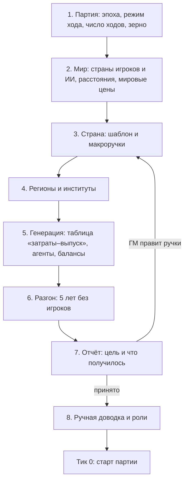

# 08. Генератор стартового состояния и конструктор партии

> Статус: черновик v0.1 · Опирается на: [01. Бухгалтерия](01-accounting.md), [02. Время](02-time.md), [03. Агенты](03-agents.md),
> [04. Производство](04-production.md), [05. Рынки](05-markets.md), [06. Статбюро](06-statistics.md), [07. Данные и правила](07-data-rules.md)
> Основа: стартовое состояние из национальных счетов (Poledna et al. 2023), согласованные стартовые балансы агентной SFC-модели
> (Caiani et al. 2016), балансировка таблиц «затраты–выпуск» методом RAS, закон Ципфа для размеров фирм (Axtell 2001)

Раздел описывает, **как ГМ создаёт мир перед партией**: что он задаёт в конструкторе, как генератор строит из этого
согласованные балансы всех агентов, зачем нужен разгон в несколько лет до старта и как проверяется, что получилась
правдоподобная страна, а не набор случайных чисел.

Главная трудность здесь — согласованность. Если стартовые балансы фирм, банков, домохозяйств и государства не сходятся,
экономика «разваливается» за первые ходы без всякого кризиса. Поэтому ГМ задаёт не каждого агента, а цели (макроручки),
а генератор подбирает под них агентов.

Здесь закрыты два пункта из списка в README: разгон 5–10 лет до старта партии (п. 5) и предупреждение, если на рынке
меньше 3 фирм, а данные не объявили его монополией (п. 4.3).

Приоритет отмечен как **ядро**, **v1** или **v2**, параметры собраны в п. 11.

---

## 1. Шаги конструктора (ядро)



| Шаг | Что задаёт ГМ | Что делает генератор |
| --- | --- | --- |
| 1. Партия | эпоху, стартовую дату, режим хода (раздел 02, п. 2), число ходов, зерно | загружает слои данных (раздел 07, п. 2) |
| 2. Мир | число стран игроков и ИИ-стран (3–8), расстояния и стоимость перевозки, резервную валюту или золото | строит ИИ-страны (раздел 03, п. 10) и мировые рынки сырья с запасами (раздел 05, п. 4) |
| 3. Страна | шаблон и 15–30 макроручек (п. 2) | переводит ручки в цели для генерации |
| 4. Регионы и институты | число регионов (5–20), их землю, недра, население, инфраструктуру; денежный режим, независимость ЦБ, законы, долю госсектора, рынок или план | раскладывает цели по регионам |
| 5. Генерация | — | строит всё по п. 3 и 4 и проверяет бухгалтерию (раздел 01, п. 10) |
| 6. Разгон | длину разгона и прошлые события (п. 5.3) | прогоняет экономику без игроков (п. 5) |
| 7. Отчёт | принимает или меняет ручки | сравнивает цели с результатом (п. 6) |
| 8. Доводка и роли | имена крупных фирм и банков, правки любых агентов, кто из игроков какую роль занимает | сводит балансы после правок (п. 7) |

Готовый мир сохраняется как слой сценария (раздел 07, пп. 2 и 10) и может использоваться снова.

## 2. Шаблоны и макроручки (ядро)

### 2.1. Шаблон

Шаблон — типичная страна своей эпохи, собранная по статистике группы реальных стран: таблицы «затраты–выпуск»,
национальные и финансовые счета, демография, распределение доходов, размеры фирм и банков. Страны в игре вымышленные,
но доли отраслей, нормы сбережений и долга у них такие же, как у реальных стран того же типа.

Для первой эпохи (2000–сейчас, раздел 07, п. 9) предлагаются 4 шаблона:

| Шаблон | По каким странам собирается | Чем отличается |
| --- | --- | --- |
| Развитая постиндустриальная | страны ОЭСР с высоким доходом | услуги около 70% выпуска, большой кредит и госдолг, низкая тень |
| Развивающаяся промышленная | страны со средним доходом и большой обработкой | высокая доля промышленности и экспорта, средняя тень, валютные долги |
| Сырьевой экспортёр | страны, где рента с ресурсов больше 10% ВВП | добыча и экспорт сырья, зависимость бюджета от цен, «голландская болезнь» |
| Бедная аграрная | страны с низким доходом | большое сельское хозяйство, неформальная занятость, мало кредита |

Источники данных для шаблонов XXI века: таблицы «затраты–выпуск» OECD ICIO и WIOD, финансовые счета ОЭСР и МВФ,
показатели Всемирного банка (WDI), демография ООН (WPP), капитал по Penn World Table, тень по Medina–Schneider (2018).
Для XX века — Maddison Project, база Jordà–Schularick–Taylor (кредит, цены жилья и ставки с 1870 года)
и исторические таблицы «затраты–выпуск» там, где они есть.

### 2.2. Макроручки

Ручка — целевое значение показателя на старте. Значение по умолчанию берётся из шаблона, у каждой ручки есть
реалистичная зона (раздел 07, п. 4).

| Ручка | Что задаёт | Единица |
| --- | --- | --- |
| `population` | население | млн человек |
| `gdp_pc` | ВВП на душу по паритету покупательной способности | доллары 2017 года |
| `urban_share` | доля городских жителей | доля |
| `va_shares` | доли сельского хозяйства, промышленности и услуг в добавленной стоимости | доли |
| `export_share` | экспорт к ВВП | доля |
| `resource_rent` | рента с природных ресурсов к ВВП | доля |
| `gov_spending` / `tax_revenue` | госрасходы и налоги к ВВП | доля |
| `gov_debt` / `gov_debt_fx` | госдолг к ВВП и доля в валюте | доля |
| `inflation` | инфляция и цель ЦБ | доля в год |
| `unemployment` | безработица по МОТ | доля |
| `gini` | неравенство доходов | 0–1 |
| `credit_gdp` | кредит частному сектору к ВВП | доля |
| `bank_top5` | доля пяти крупнейших банков в активах | доля |
| `soe_share` | доля госкомпаний в выпуске | доля |
| `shadow_share` | теневая экономика к ВВП | доля |
| `corruption` | уровень коррупции | 0–1 |
| `court_quality` | качество судов `Q_court` (раздел 03, п. 8.6) | 0–1 |
| `infra_quality` | инфраструктура к норме эпохи | доля |
| `fx_reserves` | резервы ЦБ | месяцы импорта |
| `dollarization` | доля валютных вкладов | доля |
| `inflation_memory` | память о высокой инфляции (раздел 03, п. 2.2) | да / нет |
| `cb_independence` / `stat_independence` | независимость ЦБ и статбюро (раздел 06, п. 5) | доля |

**Продвинутый режим (v1).** ГМ может задать любую величину шаблона напрямую: таблицу «затраты–выпуск», распределение
богатства, сроки госдолга. Тогда генератор берёт её как есть и подгоняет остальное.

## 3. Как генератор строит экономику (ядро)

Генерация идёт сверху вниз: сначала счета страны, потом секторы, потом отдельные агенты. На каждом шаге суммы агентов
равны итогу уровня выше.

### 3.1. Таблица «затраты–выпуск»

1. Берётся таблица шаблона на 64 отрасли и сводится к отраслям базового пакета (раздел 04, п. 2).
2. Таблица масштабируется под ВВП (`population · gdp_pc`) и балансируется методом RAS под доли отраслей, экспорта
   и импорта из ручек. RAS попеременно умножает строки и столбцы на поправки, пока суммы не совпадут с целями.
   Структура связей между отраслями при этом сохраняется.
3. Из таблицы получаются выпуск каждой отрасли, промежуточные закупки по товарам, зарплаты, прибыль, налоги
   и конечный спрос.
4. Коэффициенты рецептов (раздел 04, п. 3) проверяются по таблице: расход входа на единицу выпуска в рецептах
   отрасли должен давать тот же расход, что в таблице, с допуском `io_tolerance`. Если не даёт, генератор
   масштабирует коэффициенты рецептов и сообщает об этом.

### 3.2. Балансы секторов

| Что | Откуда |
| --- | --- |
| Капитал по отраслям и видам | отношение капитала к выпуску шаблона (Penn World Table), разложенное по поколениям с возрастом по износу |
| Финансовые активы и долги секторов | финансовые счета шаблона в долях ВВП, подогнанные под ручки `credit_gdp`, `gov_debt`, `dollarization` |
| Держатели госдолга | банки, фонды, ЦБ, домохозяйства, иностранцы — по долям шаблона |
| Резервы ЦБ | `fx_reserves` месяцев импорта в валютных депозитах и облигациях других стран |
| Жильё и земля | жилой фонд на человека и цены к доходу по шаблону, земля по типам из настроек регионов |

Каждое финансовое требование создаётся парой «актив — обязательство» операцией `issue` (раздел 01, п. 6), поэтому
нулевая сумма инструментов (раздел 01, п. 10) выполняется сразу. Чистая стоимость секторов получается сама.

### 3.3. Население

- **Возраст и регионы.** Пирамида возрастов из демографии шаблона, расселение по регионам и `urban_share`.
- **Доходы.** Распределение доходов логнормальное с параметром `σ`, который точно даёт заданный `gini`:

  ```
  σ = √2 · Φ⁻¹((gini + 1) / 2)          # Φ⁻¹ — обратная функция нормального распределения
  ```

  Верхний хвост богатства тяжелее, чем у доходов: богатство распределяется по шаблону, обычно с коэффициентом Джини
  на 0,2–0,3 выше, чем у доходов.
- **Когорты** (раздел 03, п. 3.1) получают доли по занятости, жилью, долгам и сбережениям так, чтобы их суммы совпали
  с финансовыми счетами. Неформальная занятость и скрытые доходы — по `shadow_share`.
- **Чиновники.** Число по доле госсектора, склонность к взяткам — по `corruption` (раздел 03, п. 3.12).

## 4. Фирмы и банки (ядро)

### 4.1. Фирмы

- **Размеры.** В каждой отрасли размеры фирм распределены по закону Ципфа: у фирм США показатель близок к 1 (Axtell 2001).
  Число фирм в отрасли — по статистике предприятий шаблона.
- **Кто поимённо.** Крупнейшие фирмы отрасли, которые вместе дают долю выпуска `named_firm_share`, — поимённые агенты.
  Остальные собираются в когорты по региону и размеру (раздел 03, п. 4.1).
- **Разброс эффективности.** Каждая фирма получает `A_firm` из логнормального распределения `firm_eff_sd`
  (раздел 04, п. 14.2). Более эффективные фирмы получают большую долю рынка, поэтому наценки и прибыль у лидеров выше.
- **Балансы.** Капитал, запасы, долги и деньги фирмы — доли от итогов отрасли пропорционально выпуску, с разбросом.
  Поставщики выбираются по таблице «затраты–выпуск» с учётом расстояния (раздел 04, п. 6).
- **Госкомпании** получают долю выпуска `soe_share` в отраслях, где госсектор типичен для шаблона (энергетика,
  инфраструктура, добыча), и признак `state_owned`.

### 4.2. Банки

- Число банков и их размеры подбираются по `bank_top5`: крупные банки поимённые, размеры по закону Ципфа.
- Достаточность капитала каждого банка — `car_min + car_buffer` с разбросом, кредиты и вклады — по регионам и отраслям,
  где работает банк.
- **Межбанковская сеть** строится по схеме «ядро — периферия»: несколько крупных банков кредитуют друг друга и мелкие банки,
  мелкие между собой почти не связаны. Так устроены реальные межбанковские рынки (Craig, von Peter 2014). Этого требует
  раздел 05, п. 11.2.
- **Память банков о дефолтах** (`a_0` в разделе 03, п. 5.3) начинается с доли дефолтов шаблона, а не с нуля. Иначе банки
  в начале разгона считали бы всех заёмщиков надёжными.

### 4.3. Малые рынки

Рынок — это отрасль в регионе для местных товаров, отрасль в стране для национальных и мир для мировых (раздел 04, п. 1).
Если на рынке меньше `min_firms_market` фирм, а данные не объявили его естественной монополией, монополия возникнет
из нарезки отраслей и регионов, а не из экономики. Поэтому:

1. генератор сначала добавляет на рынок фирмы до `min_firms_market` (мелкие, из когорты малого бизнеса или из соседнего региона);
2. если добавить нельзя (мало спроса или население региона слишком мало), ГМ получает предупреждение со списком таких рынков
   и выбирает: оставить, объединить регионы или объявить рынок монополией с регулируемой ценой (раздел 03, п. 4.3).

### 4.4. Цены, курс и ожидания

- **Цены.** Стартовые цены товаров в натуральных единицах (тонна, кВт·ч) берутся из шаблона, и таблица «затраты–выпуск»
  в деньгах переводится в натуральные объёмы делением на эти цены. Масштаб валюты задаёт ГМ (например, цена буханки хлеба).
- **Курс.** Стартовый курс — по паритету покупательной способности с отклонением из шаблона: у бедных стран валюта по рынку
  дешевле, чем по паритету (эффект Балассы–Самуэльсона).
- **Ожидания** на старте равны целям: инфляция — `inflation`, спрос фирм — их продажам, доход — текущему доходу.
- **Доверие к ЦБ** `ω` начинается с независимости ЦБ и `inflation_memory` (раздел 03, п. 7.3).

### 4.5. Остальной мир и группировки

- **ИИ-страны** (раздел 03, п. 10) получают размер, доход и валюту из списка стран мира: ГМ выбирает их число и типы шаблонов.
- **Группировки** (v1): территория и размер — по `corruption`, `shadow_share` и качеству полиции.

## 5. Разгон (ядро)

### 5.1. Зачем он нужен

Даже согласованные балансы на тике 0 — это снимок без истории. Без разгона:

- у агентов нет рядов для ожиданий (раздел 03, п. 2.2) и истории (`history_ticks`);
- у банков нет памяти о дефолтах за `pd_memory` тиков (раздел 03, п. 5.3);
- у статбюро нет прошлых рядов, а у игроков — статистики за прошлые годы (раздел 06, п. 9);
- первые тики уходят на подстройку цен, запасов и долгов, и игроки получают «кризис», которого нет в экономике.

### 5.2. Как идёт разгон

- Генератор прогоняет `burnin_years` лет (по умолчанию 5, то есть 60 тиков, как окно памяти банков) с отрицательными
  номерами тиков и датами до старта партии. Все роли работают по ИИ-правилам эпохи, игроков нет.
- В разгоне действуют обычные мелкие шоки эпохи: погода, колебания мировых цен, цикл ИИ-стран. Без них разгон был бы
  слишком спокойным, банки привыкли бы к редким дефолтам, и партия начиналась бы с кредитного бума (механизм Мински,
  раздел 03, п. 5.3).
- **Привязка к целям.** Пока идёт разгон, экономика уходит от целей ручек: например, безработица сама становится 8% вместо 5%.
  Поэтому в первые `burnin_steer_share` разгона генератор медленно двигает свободные параметры к целям:

  ```
  параметр_t = параметр_{t−1} · exp(знак · steer_speed · (цель − показатель_t) / |цель|)     # в пределах реалистичной зоны
  ```

  `знак` равен +1, если рост параметра поднимает показатель (склонность к потреблению и спрос), и −1, если снижает
  (эффективность подбора и безработица).

  Остаток разгона экономика идёт без подгонки, и отчёт показывает её собственную динамику.

| Цель | Какой параметр подгоняется |
| --- | --- |
| Норма сбережений домохозяйств | масштаб склонности к потреблению `c_y` (раздел 03, п. 3.3) |
| Безработица | эффективность подбора `m_eff` (раздел 05, п. 5.2) и снижение резервной зарплаты `res_decay` |
| Кредит к ВВП | маржа банков `m_loan` и предел риска `pd_max_base` (раздел 03, п. 5.3) |
| Госдолг и дефицит | целевой дефицит ИИ-бюджета `deficit_target` (раздел 03, п. 8.4) |
| Теневая экономика | налоговая мораль `morale0` и вероятность проверки `p_base` (раздел 03, пп. 3.10 и 8.6) |
| Инфляция | цель ЦБ `pi_target`, при денежном таргетировании — рост денег (раздел 03, п. 7.2) |
| Доля экспорта | спрос ИИ-стран на товары страны `m0` (раздел 03, п. 10) |

- Если параметр упёрся в границу реалистичной зоны, а цель ещё не достигнута, отчёт пишет, что цель недостижима
  при правдоподобных параметрах: например, безработица 2% при высокой минимальной зарплате и жёстком трудовом праве.
- Разгон детерминирован: тот же мир, ручки и зерно дают тот же результат (раздел 02, п. 7).

### 5.3. История страны (ядро)

ГМ может вставить в разгон прошлые события как шоки (раздел 09): гиперинфляцию 8 лет назад, банковский кризис 3 года назад,
войну. Тогда страна начинает партию с памятью о них: высокой долей валютных вкладов, недоверием к банкам и ЦБ,
осторожными банками. Длина разгона при этом растёт так, чтобы событие в него поместилось.

### 5.4. Сколько это стоит по времени

При целях раздела 02, п. 9 (до 5 секунд на тик для 10 стран) 5 лет разгона — около 5 минут, 10 лет — около 10 минут.
Отчёт с повторной генерацией после правки ручек — ещё один разгон. Для быстрой проверки идей ГМ может поставить
`burnin_years = 0`: тогда старт идёт сразу из согласованных балансов, как в модели Poledna et al. (2023), но с
предупреждением, что первые ходы могут показывать подстройку, а не экономику.

## 6. Отчёт о старте (ядро)

После разгона ГМ видит таблицу по каждой стране:

| Показатель | Цель | Получилось | Допуск | Статус |
| --- | --- | --- | --- | --- |
| Безработица | 6% | 6,4% | ±1 п.п. | в допуске |
| Кредит к ВВП | 80% | 61% | ±10 п.п. | вне допуска: банки упёрлись в норматив капитала |

- Допуск каждой ручки — `target_tolerance` в данных.
- По показателю вне допуска отчёт называет причину: какой параметр упёрся в границу зоны или какое ограничение
  сработало (норматив капитала, нехватка рабочих, предел спроса).
- ГМ может принять результат, поменять ручки и перезапустить или перезапустить с другим зерном.
- В отчёт входят и предупреждения проверки данных (раздел 07, п. 11), в том числе о малых рынках (п. 4.3).

## 7. Ручная доводка (ядро)

- ГМ даёт имена крупным фирмам и банкам, меняет владельцев, долги, капитал и любые числа агентов.
- Каждая правка проводится базовыми операциями раздела 01, п. 6, с парной записью у второй стороны. Например, если ГМ
  увеличил кредит фирмы, у банка растут кредиты, а у фирмы — депозит. Поэтому балансы сходятся после любой правки.
- Если правка сильно меняет экономику (огромный долг, пузырь цен жилья), генератор предлагает короткий доразгон
  `reburnin_ticks` тиков. ГМ может отказаться: это законный способ начать партию в кризисе.

## 8. Кризисный старт (ядро)

Партию можно начать с уже накопленных проблем, а не со спокойной экономики. Для этого ГМ:

- ставит ручки за реалистичной зоной (долг 150% ВВП, кредитный бум, переоценённый фиксированный курс);
- вставляет в историю события (п. 5.3);
- после разгона вручную добавляет перекосы (п. 7).

Кризис тогда возникает сам в первые ходы, а игроки должны найти его причину.

## 9. Связь с другими разделами

- Генератор использует таблицы и рецепты раздела 04, балансы и операции раздела 01, правила агентов раздела 03.
- Стартовую межбанковскую сеть требует раздел 05, п. 11.2, стартовые ряды статистики — раздел 06, п. 9.
- Готовый мир — слой сценария раздела 07, проверки данных — раздел 07, п. 11.
- Шоки истории в разгоне описаны в разделе 09.
- Проверка, что шаблоны и разгон дают правдоподобные страны, — раздел 10.

## 10. Какие кризисы порождает этот раздел

| Кризис | Механизм |
| --- | --- |
| Ложный кризис на старте | без разгона первые тики уходят на подстройку балансов; от этого защищает разгон (п. 5) |
| Кредитный бум после спокойного разгона | банки без памяти о дефолтах слишком смелы; защита — шоки эпохи в разгоне и стартовая память банков (пп. 4.2 и 5.2) |
| Наследие прошлого кризиса | долларизация, недоверие к ЦБ и банкам из истории страны (п. 5.3) |
| Кризисный старт по замыслу ГМ | перекосы, заложенные ручками, историей или ручной правкой (п. 8) |
| Ложная монополия | слишком мелкая нарезка рынков; защита — п. 4.3 |

## 11. Параметры по умолчанию

| id | Смысл | Единица | Диапазон | По умолчанию |
| --- | --- | --- | --- | --- |
| `burnin_years` | длина разгона | годы | 0–20 | 5 |
| `burnin_steer_share` | доля разгона с подгонкой к целям | доля | 0–1 | 0,6 |
| `steer_speed` | скорость подгонки параметров | доля за тик | 0–0,2 | 0,05 |
| `target_tolerance` | допуск цели в отчёте | п.п. или доля | по ручке | безработица ±1 п.п., кредит ±10 п.п., ВВП на душу ±5% |
| `io_tolerance` | допуск расхода по рецептам против таблицы | доля | 0–0,2 | 0,05 |
| `named_firm_share` | доля выпуска отрасли у поимённых фирм | доля | 0–1 | 0,5 |
| `min_firms_market` | меньше скольких фирм на рынке — предупреждение | шт. | 1–10 | 3 |
| `reburnin_ticks` | доразгон после ручной правки | тики | 0–36 | 12 |

## 12. Открытые вопросы

- [ ] Длина разгона (предлагаю: 5 лет по умолчанию, как окно памяти банков; до 20 лет по желанию ГМ; 0 — для быстрой проверки
  с предупреждением).
- [ ] Привязка к целям (предлагаю: в первые 60% разгона двигать свободные параметры к целям внутри реалистичных зон, потом
  отпустить; отчёт «цель / получилось» с причинами).
- [ ] Набор макроручек (предлагаю: около 25 ручек из таблицы п. 2.2, всё остальное — из шаблона; прямое задание любой
  величины — v1).
- [ ] Шаблоны первой эпохи (предлагаю: 4 — развитая, развивающаяся промышленная, сырьевой экспортёр, бедная аграрная).
- [ ] История страны в разгоне (предлагаю: в ядре, ГМ вставляет прошлые кризисы шоками, и страна их «помнит»).
- [ ] Малые рынки (предлагаю: генератор сам добавляет фирмы до 3, предупреждает ГМ только там, где не может).

## Источники

- Poledna S., Miess M. G., Hommes C., Rabitsch K. (2023). Economic forecasting with an agent-based model.
  *European Economic Review* 151.
- Caiani A., Godin A., Caverzasi E., Gallegati M., Kinsella S., Stiglitz J. (2016). Agent based-stock flow consistent
  macroeconomics: towards a benchmark model. *Journal of Economic Dynamics and Control* 69.
- Bacharach M. (1970). *Biproportional Matrices and Input-Output Change*. Cambridge University Press (метод RAS).
- Axtell R. (2001). Zipf distribution of U.S. firm sizes. *Science* 293.
- Craig B., von Peter G. (2014). Interbank tiering and money center banks. *Journal of Financial Intermediation* 23(3).
- Medina L., Schneider F. (2018). Shadow economies around the world: what did we learn over the last 20 years?
  *IMF Working Paper* 18/17.
- Jordà Ò., Schularick M., Taylor A. (2017). Macrofinancial history and the new business cycle facts.
  *NBER Macroeconomics Annual* 31. База: https://www.macrohistory.net/database/
- Feenstra R., Inklaar R., Timmer M. (2015). The next generation of the Penn World Table. *American Economic Review* 105(10).
- Bolt J., van Zanden J. L. (2020). Maddison Project Database. https://www.rug.nl/ggdc/historicaldevelopment/maddison/
